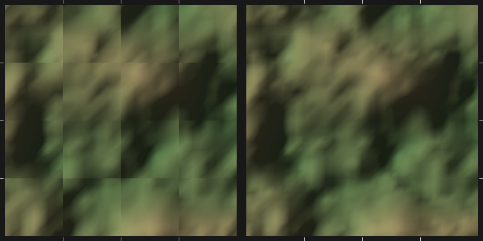

# Colo-3D｜Unity 工厂建造原型 · 源码节选

Colo-3D 是一个用 Unity 6 开发的 3D 工厂建造原型。主要开发时间是 2025 年 12 月到 2026 年春，之后暂停。这个仓库从原型里节选三部分可以单独阅读的代码：存档框架 Scribe、区块地形的无缝法线，以及工厂内部编辑器的网格绘制。游戏本体、美术资源和其余玩法代码不在这里。

**我的分工**　Scribe 存档框架由我独立设计并实现。区块法线和网格绘制是我在原型中写的功能。原型的其他部分（工厂物流、电力、世界地图等）有编程 Agent 参与开发，没有收录。整理这个仓库时，地形模块的抽取、全部测试、对比图工具和下文提到的一处修正，都由编程 Agent 协作完成。

[演示视频（3 分 15 秒）](https://github.com/DaliBerr/Colo-Portfolio/releases/tag/demo-video) · [Scribe 源码](Assets/Scripts/Scribe) · [区块法线](Assets/Scripts/Terrain/ChunkNormals.cs) · [网格绘制](Assets/Scripts/GridUI) · [测试](Assets/Editor/Test)

## Scribe：按字段读写的存档框架

每个需要保存的对象实现一个 `ExposeData()`，同一个方法既负责写也负责读，由 `Scribe.mode` 决定当前方向。这个写法借鉴了 RimWorld。业务代码只描述"我有哪些字段"，不关心文件格式；公共层把字段组织成带版本号的 JSON 文档，再交给调用方的流。

```csharp
public void ExposeData()
{
    Scribe_Values.Look("name", ref Name, "未命名");          // 基础值，读档缺失时取默认值
    Scribe_Deep.Look("inventory", ref Inventory);            // 嵌套对象
    Scribe_Refs.Look("target", () => Target, t => Target = t); // 跨对象引用，读完整个文档后统一解析
    Scribe_Polymorph.LookList("modules", ref Modules);       // 多态列表，只能创建白名单里的类型
}
```

几个设计点：

- **按名字存字段**。字段以标签为键，读档时找不到就退回默认值，所以给类加字段不会让旧存档读不出来。
- **引用延后解析**。`Scribe_Refs` 先记下 ID，整个文档读完后由 `ScribeRefs.ResolveAll` 统一回填，互相引用、甚至成环的对象也能还原成同一批实例。
- **多态只认白名单**。存档里写的是类型 ID，读档时从 `PolymorphRegistry` 查表创建；不认识的 ID 得到 `null`，不会按存档里的字符串反射任意类型。
- **失败可以放弃**。保存中途出错时调用 `Scribe.Abort()`，丢掉未写完的文档并让 Scribe 回到空闲状态，下一次保存不受影响。调用方的写法见 [Reference/ScribeSaveManager.cs](Reference/ScribeSaveManager.cs)。

[9 个往返测试](Assets/Editor/Test/Scribe/ScribeRoundTripTests.cs)覆盖基础值、成环引用、旧存档缺字段、多态白名单、文件版本、非 JSON 输入、保存失败后放弃，以及下面这个修正。

**整理时发现并修正的问题**　`Scribe_Values.LookDictStrEnumInt32` 读档时只认 `Dictionary<string, object>`，而从 JSON 读回来的是 `JObject`，于是整张表都退回默认值。游戏里的按键绑定就是用它保存的，重启后会丢失。仓库里的版本已经修正（[ScribeValue.cs](Assets/Scripts/Scribe/ScribeValue.cs) 中标注"作品集修正"的两行），并用 `EnumDictionary_RoundTripsThroughBothApis` 防止回归；在修正前这个测试是失败的。`Abort()` 是最近加入的，游戏仓库里尚未提交。除这两处外，Scribe 的代码与游戏一致。

## 区块地形：让相邻区块的法线在接缝处一致

地形按区块分别生成网格。如果每块只用自己的三角形求法线（`Mesh.RecalculateNormals` 就是这样），边界顶点只能看到一侧的三角形，相邻两块在同一个点上算出的法线不同，光照会沿区块边界出现折线。

游戏的做法是直接从高度场求法线：中心差分 `n = normalize(hL − hR, 2·cellSize, hD − hU)`，区块内部用已生成的高度，边界处向区块外多采样一格。相邻两块在同一顶点读到的是同一组高度，法线完全一致。



*4×4 个区块、每块 8×8 格。左图 189 个接缝顶点上，相邻区块法线的最大夹角 45.4°，平均 14.7°；右图为 0°。图和数字都由下方命令生成。*

[ChunkNormals.cs](Assets/Scripts/Terrain/ChunkNormals.cs) 是从游戏 `ChunkMeshGenerator.BuildSeamlessNormals` 抽出的纯 C# 版本，公式逐项一致。原函数依赖 Unity 的 `Mesh` 和游戏的群系噪声，作品集把高度采样抽象成 `IVertexHeightSampler` 接口，测试和出图时用确定性的函数代替。原文件放在 [Reference/ChunkMeshGenerator.cs](Reference/ChunkMeshGenerator.cs)（第 611 行），游戏里保留了 `seamlessNormals` 开关，便于做 A/B 对比。

[4 个测试](Assets/Editor/Test/Terrain/ChunkSeamNormalTests.cs)验证：只用本块三角形时接缝处法线明显不一致；共享高度场时接缝夹角小于 0.001°；把一大块切成 3×3 块，结果与整块计算相同；平地上两种方法都朝正上方。

## 网格绘制：整张网格是一个 Mesh

工厂内部编辑器和组装台上的格子不是一格一个 `Image`，而是继承 `MaskableGraphic`，在 `OnPopulateMesh` 里把所有格子和格线写进同一个网格，整张网格一次绘制。两处网格都继承同一个基类，这里收录了组装台那一个。[GridGraphicBase](Assets/Scripts/GridUI/GridGraphicBase.cs) 负责格子尺寸自适应、屏幕坐标与格子坐标互转和画线；[AssemblerGridGraphic](Assets/Scripts/GridUI/AssemblerGridGraphic.cs) 在此基础上画激活区、占用格、悬停和放置预览（合法为绿色，不合法为红色）。

基类与游戏一致。`AssemblerGridGraphic` 去掉了依赖游戏建筑和蓝图类型的缩略图接口，绘制逻辑不变。

## 运行测试

**不装 Unity**　测试工程把 Scribe、地形模块和全部测试编译到 .NET 9 下，用 NUnit 运行。在仓库根目录执行：

```powershell
dotnet test Tools/DotnetTests
```

13 个测试应全部通过。网格绘制依赖 UnityEngine.UI，不在这个工程里。

重新生成上面的对比图：

```powershell
dotnet run --project Tools/SeamFigure -- Docs/chunk-seam.png
```

**在 Unity 中**　用 Unity Hub 把仓库根目录添加为项目，以 **Unity 6000.3.9f1** 打开，Package Manager 会解析 Newtonsoft Json、Test Framework 和 uGUI。打开 **Window → General → Test Runner → EditMode**，运行 `ScribeRoundTripTests` 和 `ChunkSeamNormalTests`。

## 目录

| 路径 | 内容 |
| --- | --- |
| `Assets/Scripts/Scribe` | 存档框架，程序集 `Lonize.Scribe`，不引用 UnityEngine |
| `Assets/Scripts/Terrain` | 区块法线与接缝度量，纯 C# |
| `Assets/Scripts/GridUI` | 网格绘制，依赖 uGUI |
| `Assets/Editor/Test` | EditMode 测试 |
| `Reference` | 游戏原文件，仅供对照阅读，不参与编译 |
| `Tools/DotnetTests` | 不依赖 Unity 的测试工程 |
| `Tools/SeamFigure` | 生成接缝对比图 |

原型演示视频里使用的建筑模型来自 Kenney（CC0），不包含在这个仓库中。

另一个作品：[《苍灵志》技术作品集](https://github.com/DaliBerr/Lilith-Portfolio)，Unity 6 2D 动作构筑游戏中的法术图校验、通用 UI/事件/存档模块和战斗卡顿排查。
